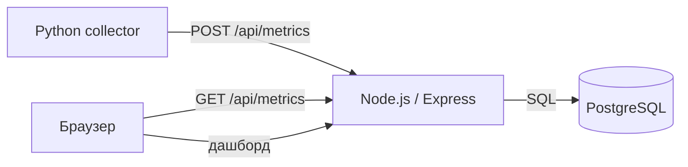

# Мониторинг доступности сервисов

Небольшая система мониторинга: Python-воркер периодически опрашивает URL, Node.js API
сохраняет метрики в PostgreSQL, а веб-дашборд показывает статус сервисов, uptime,
среднюю задержку и журнал событий.

## Архитектура



## Стек

- Python 3 + `requests` — сбор метрик
- Node.js 18+ + Express — REST API и раздача дашборда
- PostgreSQL — хранение замеров
- Bootstrap + Chart.js — дашборд

## Быстрый старт

### 1. PostgreSQL

Создайте базу (таблица создастся автоматически при старте API):

```bash
createdb -U postgres info
```

### 2. API и дашборд

```bash
cd monitoring-nodejs
cp .env.example .env      # укажите свои доступы к БД
npm install
npm start
```

Дашборд: <http://localhost:3000>

### 3. Коллектор

```bash
python -m venv .venv
source .venv/bin/activate
pip install -r requirements.txt
python collector.py
```

## API

| Метод | Путь             | Описание                                  |
|-------|------------------|-------------------------------------------|
| GET   | `/healthz`       | Liveness-проверка                         |
| GET   | `/readyz`        | Readiness-проверка (доступность БД)       |
| POST  | `/api/metrics`   | Приём метрики от коллектора               |
| GET   | `/api/metrics`   | Сервисы, история замеров и журнал событий |

## Переменные окружения

### API (`monitoring-nodejs/.env`)

| Переменная    | По умолчанию | Описание              |
|---------------|--------------|-----------------------|
| `PORT`        | `3000`       | Порт HTTP-сервера     |
| `DB_USER`     | —            | Пользователь PostgreSQL |
| `DB_PASSWORD` | —            | Пароль PostgreSQL     |
| `DB_HOST`     | —            | Хост PostgreSQL       |
| `DB_PORT`     | —            | Порт PostgreSQL       |
| `DB_NAME`     | —            | Имя базы данных       |

### Коллектор

| Переменная              | По умолчанию                       | Описание                     |
|-------------------------|------------------------------------|------------------------------|
| `NODE_API_URL`          | `http://localhost:3000/api/metrics` | Куда отправлять метрики      |
| `POLL_INTERVAL_SECONDS` | `10`                               | Интервал опроса, секунды     |
| `REQUEST_TIMEOUT_SECONDS` | `3`                              | Таймаут запроса к сервису    |
| `LOG_LEVEL`             | `INFO`                             | Уровень логирования          |

## Структура

```
collector.py                  # Python-воркер сбора метрик
requirements.txt
monitoring-nodejs/
  server.js                   # Express API + health-проверки
  db.js                       # Пул подключений и инициализация схемы
  public/index.html           # Дашборд
  .env.example
waste/                        # Старая версия на FastAPI/SQLAlchemy (не используется)
```

## Ограничения и план развития

- [ ] Dockerfile и `docker-compose` для всего стека
- [ ] CI/CD (GitHub Actions): линтеры, тесты, сборка образа, деплой
- [ ] Миграции БД вместо `CREATE TABLE IF NOT EXISTS` при старте
- [ ] Prometheus-метрики, Grafana и алерты
- [ ] Тесты для API и коллектора
- [ ] Ретеншн старых записей в `server_logs`
